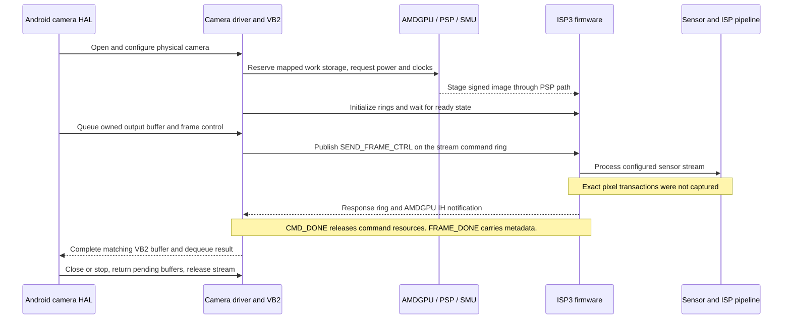

# One Mero sensor frame and the missing sensorless handoff

**CONFIRMED static reference path, build 9601.** The ordinary physical-camera flow connects the host's output buffer to a firmware frame-control handler and connects the frame-done handler back to the Linux buffer queue. This is a reconstruction from the shipped Mero software. No known-good per-frame recording was available to associate a particular camera exposure with a particular buffer. The receptor for host frame *information* can be traced too, but its chain ends at a different point. [Artifacts and hashes](isp3-firmware-and-smu.md#firmware-images-and-their-consumers) · [Memory input](isp3-memory-input.md)

The diagram groups phases; PSP staging and work-area setup can occur during driver initialization before the application opens its first frame. The command and response rings have separate cursors. Firmware produces response records and the host consumes them. [Ring layout, publication and ownership](isp3-command-protocol.md)

| Stage | Function-level evidence | Dependency and boundary |
|---|---|---|
| 1–2. Open and initialize firmware | HAL `amdCamera3DriverInterface::open_device` calls `open` at `H:8c27d`; kernel `amd_cam_open` calls `vb2_reqbufs` at `K:a43ff6`. The ISP software initialization exposes `open_camera_imp`; its branches call `isp_ip_pwr_on`, `isp_fw_start` and `isp_snr_open` at `K:a93de8/a93e6f/a9409a`. `isp_fw_boot` sets software state 3 only on the observed readiness branch. | Android entry, board power, accepted firmware and sensor startup are distinct dependencies. [Boot stages](isp3-firmware-boot.md) |
| 3–4. Allocate rings and set up stream | A kernel-owned work arena is subdivided into four command and four response rings. `isp_init_stream → isp_setup_stream` can skip CVIP metadata/statistics allocation. From reset, physical camera 0 selects ring 1 and tag 0; physical camera 1 selects ring 2 and tag 1. | Ring math is offline-verifiable. Power, memory visibility, camera profile and selected stream mode are platform-specific. [Stream mapping](isp3-command-protocol.md) · [CVIP condition](isp3-buffer-dependencies.md) |
| 5–6. Allocate and assign an output buffer | The graphics allocation path pins GTT backing and obtains a GPU aperture offset. HAL `getBufDetails` obtains the pitch; the private gralloc operation resolves the MC address for that particular GEM object. `map_img_addr` fills dimensions, pitches, low/high address words and extents. | Mero graphics-memory contract. For example, the ordinary 640 × 480 NV12 640-byte-pitch case has 307,200 luma bytes and 153,600 chroma bytes. The example describes an **output**. [Address provenance and bounds](isp3-dma-portability.md) |
| 7–9. Submit, dispatch and process | `Q_drvReq → enq_request → vb2_qbuf → buffer_queue → set_frame_ctrl_imp → isp_fw_send_frame_ctrl`. The wrapper issues `0x02050001` with an indirect `0xa50`-byte body at `K:a9029f–a902bc`. The host orders the slot copy and publishes the write cursor. The signed firmware directory row at file `+0x17030` points to `0x600936e8`; the RAM variant points to `0x60098d34`. | This is the normal producer/receiver pairing for sensor capture. Sensor, calibration and output buffer are prerequisites in the traced path. **UNKNOWN** which internal fixed-function stages ran on a particular exposure. [Host calls and V4L2 controls](isp3-frame-evidence.md#one-complete-output-buffer-path-in-the-shipped-camera-stack) |
| 10–12. Notify, decode and complete | CGS/AMDGPU interrupt client 5 signals the ring worker. The worker can also drain after a timeout. The host verifies each record's checksum. `CMD_DONE` matches command ID and sequence; `FRAME_DONE` → `isp_fw_resp_frame_ctrl_done` → callback event `0x10` → `func_lib_callback` → `vb2_buffer_done` at `K:a45af4`. | The metadata reference and pending buffer are needed for ordinary frame completion. A successful command acknowledgement alone is insufficient. [IRQ dispatch](isp3-interrupts.md) · [Response decoding](isp3-command-protocol.md#response-fields-and-lifetimes) |
| 13–14. Dequeue and clean up | `DQ_drvRes` calls the dequeue ioctl at `H:8dadd`; the kernel calls `deq_result` at `K:a44619` and copies result information at `K:a3e632`. `stop_streaming` can instead return an outstanding VB2 buffer with ERROR at `K:a44e36–a44e3b`. `buffer_cleanup` frees per-buffer GPU allocations at `K:a44d0c/a44d33`; `close_camera_imp` calls `isp_uninit_stream` and has sensor-close and ISP power-off paths. `ispm_sw_uninit` calls `isp_unregister_isr` at `K:a78b2c`. | Queue return, command-package release, stream teardown and backing-object lifetime are different events. The hardware must have stopped accessing a buffer before it is reused. [Pending command lifetime](isp3-command-protocol.md) · [Mapping lifetime](isp3-dma-portability.md) |

`K:` is relative to `0xffffffff81000000` in the original Mero x86 kernel; `H:` is an ELF VA in its 64-bit `camera.raven.so` (`907dd72aea4798cd6c5d115653abb246ac06b452c35c0d91d31960e7fd402eb2`).

## Proposed sensorless equivalent

**HYPOTHESIS:** kernel-owned source and destination objects could replace gralloc *if* they are mapped into a proven ISP-visible domain, with verified range, direction, cache synchronization and lifetime. The genuine Mero transport can carry an indirect frame-information package with a valid stream tag. The reconstructed receiver validates the package and queues metadata. No observed stock host edge connects application-owned pixels to the package's input plane, and no matched trace connects that plane through read-DMA to output completion. The four missing graphics-port power/clock handlers are a separate Jupiter obstacle even if that Mero software edge is found. [Input-consumer boundary](isp3-memory-input.md) · [SMU comparison](isp3-smu-compatibility.md)
